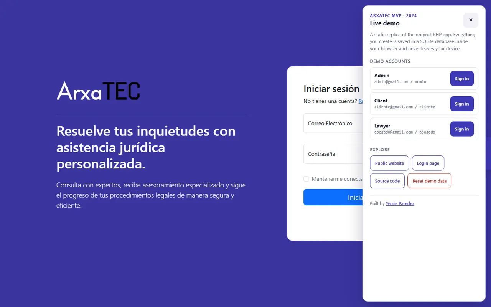

# ARXATEC — THE ORIGINAL PROTOTYPES

**A public archive of where Arxatec began and how the idea evolved.**

  

[Explore the projects](#-the-projects) · [Read the story](#-the-story) · [Meet the team](#-the-people) · [Run the original MVP demo](arxatec-mvp/README.md#-browser-based-demo)

 

The login page of the original 2024 MVP, preserved in this repository.

> [!IMPORTANT]
> This repository preserves old, deprecated versions of Arxatec. It is a historical record, **not the current Arxatec platform** or a reference for its present-day architecture. Some features and integrations are incomplete; do not use these prototypes in production.

## ⚖️ What is Arxatec?

Arxatec began with a simple idea: make it easier for people to reach a lawyer. The team later realized that, for clients to use the platform, their lawyers needed a reason to use it first. In Peru, a lawyer's work can be spread across spreadsheets, cloud drives and paper. Arxatec set out to bring the work of a legal practice together in one place.

The projects here show different stages of that idea: the first legal-advice MVP, followed by an early platform, its backend, and versions of the public website.

## 📖 The story

### 2024: the first MVP

[ARXATEC MVP](arxatec-mvp/README.md) is where it started. **Yemis Paredez** designed and built this first version: a PHP application where clients could request legal advice by video or message. Its original interface is preserved alongside a browser-based demo.

### June 27, 2025: the institute project · version 0.0.1

After the MVP came an institute final project, presented at **SENATI on June 27, 2025**. Six months of work produced a mobile app, a website and a backend. It looked impressive, and the team was proud of it, but the internals were difficult to maintain.

The **0.0.1** entry is dated June 27, 2025, the day of that presentation. It is not the date of the rebuild described below. The lesson was that building a project and building a product for real people are different challenges.

### October 2025: starting over

In October 2025 the team deleted what they had and started again. It was the third time starting from scratch, though the first hardly counted. This time they agreed on a few rules:

- Avoid overengineering and long meetings.
- Document the work thoroughly.
- Make decisions, even when they are difficult.
- Adapt clean architecture and vertical slices to the team's needs, balancing speed, clarity and organization against their trade-offs.

Before writing the platform that followed, the team spent October, November and December asking questions about structure, migrating modules and documenting an API that could eventually have thousands of endpoints. Those decisions shaped the direction of the later product; the code in this archive remains an older snapshot, not a description of the current system.

### The mobile app

There was also a mobile app from that period, including a dashboard with earnings, daily events and recent cases. **No APK files or mobile app source are included in this repository snapshot.**

## 🗂️ The projects

| Project | What is preserved | Technologies |
| --- | --- | --- |
| [**arxatec-mvp**](arxatec-mvp/README.md) | Yemis's 2024 legal-advice MVP and its browser-based demo | PHP, MySQL/MariaDB, Bootstrap, JavaScript |
| [**arxatec-platform**](arxatec-platform/README.md) | An early client and lawyer platform | React, TypeScript, Vite, Tailwind CSS |
| [**arxatec-service**](arxatec-service/README.md) | The platform's historical backend and database schema | Express, TypeScript, Prisma, PostgreSQL, Redis |
| [**arxatec-site**](arxatec-site/README.md) | A multilingual public website | Astro, React, Tailwind CSS |
| [**arxatec-testing**](arxatec-testing/README.md) | A separate experimental website snapshot | Astro, React, Tailwind CSS |

Each project has its own README with its purpose, structure and local setup. The original MVP can also be explored through its [browser-based demo](arxatec-mvp/README.md#-browser-based-demo), which can be built and served locally.

## 👥 The people

| | Name | Contribution |
| :---: | --- | --- |
| 🌱 | **Yemis Paredez** | Designed and built the original 2024 MVP. |
| ⚖️ | **Rafael Martín Aguirre Gonzalo** | Arxatec team member in the later stages of the project. |
| ⚖️ | **Yhefry Michael Gaspar Almonacid** | Arxatec team member in the later stages of the project. |
| 🤝 | **Harvey Yerik Vasquez Huaranga** | Helped build a substantial part of the later work until June, before moving on. |

Other contributors are represented in the repository's Git history. The [MVP README](arxatec-mvp/README.md#-author) includes more about its author.

## 🔭 Following Arxatec today

Arxatec continues to evolve beyond these prototypes. For questions about the current product or its releases, use the Help Center and the Updates panel inside the current platform.

## 📄 License

The original MVP has its own [MIT license](arxatec-mvp/LICENSE). There is no repository-wide license file for the other archived projects; check their package metadata and the terms of any bundled third-party assets before reuse.
