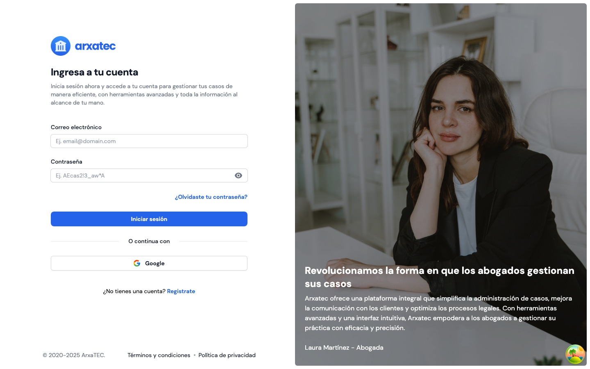

<div align="center">


# ARXATEC PLATFORM

**An early workspace for lawyers and clients.**

    

[Repository overview](../README.md) · [The story](../README.md#-the-story) · [Backend service](../arxatec-service/README.md)

</div>

<br>



## 📖 The story

After the original [2024 MVP](../arxatec-mvp/README.md), Arxatec's focus expanded from connecting clients with legal advice to organizing a lawyer's daily work. This React application is an early snapshot of that later platform. It preserves the team's experiments with role-based interfaces, cases, community and shared tools.

> [!IMPORTANT]
> This is an archived, incomplete prototype, not the current Arxatec platform. Screens, services and integrations may be unfinished or depend on the historical backend.

## ✨ What is in the prototype

| Area | Examples in the source |
| --- | --- |
| ⚖️ **Lawyers** | Case dashboards, case creation, clients and case exploration. |
| 🙋 **Clients** | Case creation, case lists and case detail screens. |
| 👥 **Community** | Communities, posts, articles and lawyer profiles. |
| 🗓️ **Shared workspace** | Authentication, onboarding, calendar, chats, notifications and settings. |
| 🌐 **Languages** | Spanish, English and Quechua translation files. |

These describe screens and modules in the archive, not a guarantee that every workflow is connected end to end. The [service](../arxatec-service/README.md) has its own setup and limitations.

## 🗂️ Project structure

```text
arxatec-platform/
├── public/                 Static public assets
├── scripts/                Translation-key generator
├── src/
│   ├── assets/             Images, icons and translation JSON files
│   ├── components/         Shared UI, layouts and access guards
│   ├── config/             Environment configuration
│   ├── docs/               Architecture and translation guides
│   ├── lang/               Generated translation keys
│   ├── modules/            Client, lawyer and shared feature areas
│   ├── routes/             Application and role-based routes
│   ├── services/           Shared services
│   ├── store/              Application state
│   └── utilities/          Shared helpers
├── .env.sample             Example frontend variables
└── package.json            Dependencies and scripts
```

The lawyer module is spelled `src/modules/laywer/` in this snapshot. Feature folders group their own components and, where applicable, hooks, services and types. See the [architecture guide](src/docs/ARCHITECTURE_GUIDE.MD) for a closer look.

## 🚀 Running locally

Use Node.js 22 or newer and npm. The historical lockfile and peer dependencies do not resolve cleanly with a current `npm ci`. The following installation was checked with Node.js 24 and npm 11; it resolves the declared version ranges without changing the archived lockfile:

```bash
git clone https://github.com/arxatec-engine/arxatec-prototype.git
cd arxatec-prototype/arxatec-platform
npm install --no-package-lock --legacy-peer-deps
cp -n .env.sample .env.local
npm run dev
```

Vite normally serves the app at [http://localhost:5173](http://localhost:5173). Review `.env.local` before running the app; remove the duplicate `VITE_API_BASE_URL` entry in the sample and set the remaining value to `http://localhost:3000/api/v1` for the local backend. Google sign-in and maps require their own client ID and API key. Vite exposes `VITE_` values to the browser, so do not put secrets there. Some historical requests also use hard-coded URLs.

> [!WARNING]
> The archived production build currently fails TypeScript checks, including a missing `data_state_model` and errors in case and toast-related code. Starting the development server does not mean every page will work. The legacy peer-dependency option bypasses a conflict between the archived chart packages; it does not fix compatibility.

| Command | Purpose |
| --- | --- |
| `npm run dev` | Start the Vite development server. |
| `npm run build` | Run TypeScript checks and build with Vite; currently fails as described above. |
| `npm run lint` | Run ESLint. |
| `npm run preview` | Preview an existing Vite build. |
| `node scripts/generate-locale-keys.js` | Regenerate translation keys after editing the Spanish source file. |

For details on translations, see the [language guide](src/docs/LANG_GUIDE.MD).

## 👥 People

The later Arxatec team included **Rafael Martín Aguirre Gonzalo** and **Yhefry Michael Gaspar Almonacid**, with substantial contributions from **Harvey Yerik Vasquez Huaranga** until June. **Yemis Paredez** built the preceding 2024 MVP. See the [repository overview](../README.md#-the-people) and Git history for the wider context and contributors.
